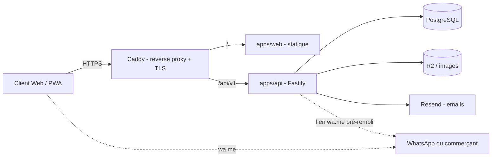
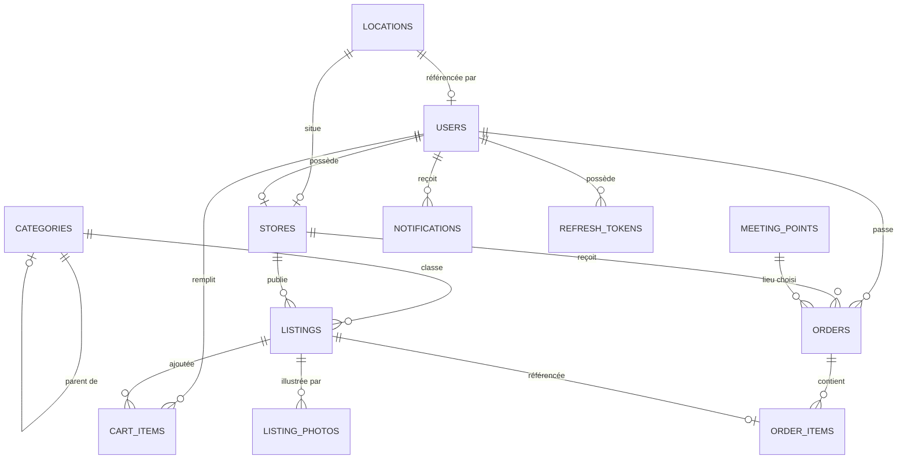
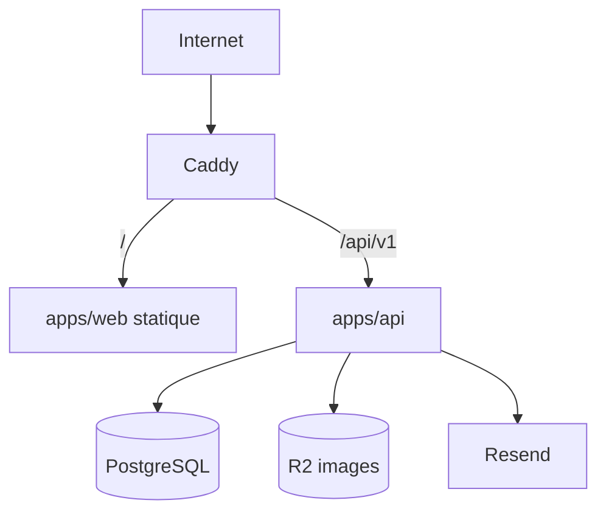

# 2ie Market — Architecture technique (version validée v1.1)

> Date : 19 novembre 2026
> Statut : plan d'architecture validé avant développement. **Aucun code applicatif n'est encore écrit.**

## 0. Décisions validées

| # | Question | Décision |
|---|---|---|
| 1 | Notation des étages | `R0` (rez-de-chaussée), `R1` (1er étage), `R2`… — **pas** `R+1` |
| 2 | Visibilité de la localisation | **Privée** : révélée uniquement au commerçant concerné par une commande |
| 3 | Modération des annonces | **Publication directe** : pas de file de validation admin |
| 4 | Restriction d'inscription | **Ouverte à toute adresse email** (aucun filtre de domaine scolaire) |
| 5 | Modalités de remise | **Les deux** : remise en main propre **et** point de rendez-vous par site |

Conséquences directes sur le modèle : suppression de l'état `REJECTED`/`PENDING_REVIEW`, ajout des tables `meeting_points` et des champs de livraison sur `stores` et `orders`.

---

## 1. Périmètre et principes directeurs

- Marketplace interne à la communauté de l'école (sites de **Kamboinsin** et **Ouaga**).
- Plusieurs commerçants, chacun avec **une** boutique personnelle.
- Trois types de publications : produit physique, article d'occasion, service.
- **Aucun paiement en ligne** : la commande est un engagement de remise, le règlement se fait hors plateforme.
- Contact commerçant via lien profond WhatsApp (`wa.me`) — pas d'API payante.
- Mobile-first, élégant, sécurisé, économique et évolutif.

**Principe d'évolution** : monolithe modulaire d'abord. On n'extrait pas de microservices tant que la charge ne le justifie pas.

---

## 2. Stack technique et justifications

| Couche | Choix | Justification |
|---|---|---|
| Frontend | React 19 + TypeScript + Vite + Tailwind CSS | Démarrage rapide, bundle léger, excellent pour le mobile |
| Routing / cache | TanStack Router + TanStack Query | Cache serveur, pagination, revalidation automatique |
| État client | Zustand (panier persisté `localStorage`) | Suffisant, pas de Redux |
| Backend | Node.js 22 + Fastify + TypeScript | Plus rapide qu'Express, plugins natifs |
| ORM | Prisma | Migrations, types générés, requêtes paramétrées |
| Base | PostgreSQL 16 (Neon en dev, VPS en prod) | Full-text search, robustesse, évolutivité |
| Validation | Zod dans `packages/shared` | Une seule règle partagée client/serveur |
| Images | Cloudflare R2 (free tier) ou disque derrière Caddy | Coût nul ou quasi nul |
| Emails | Resend (free tier) | Notification « nouvelle commande » |
| Auth | JWT 15 min en cookie httpOnly + refresh token hashé en DB | Révocable et stateless |
| Hébergement | Docker Compose + Caddy (TLS auto) sur 1 VPS | ~5-10 €/mois |

---

## 3. Architecture globale



---

## 4. Modèle de données

### 4.1 Tables

#### `locations`
| Champ | Type | Contraintes |
|---|---|---|
| `id` | UUID | PK |
| `site` | ENUM `KAMBOINSIN`, `OUAGA` | NOT NULL |
| `building_number` | VARCHAR(10) | NOT NULL |
| `room_number` | VARCHAR(10) | NOT NULL |
| `floor` | SMALLINT | NOT NULL, `0` = rez-de-chaussée |
| `reference` | VARCHAR(32) | NOT NULL — ex. `B1.87 R1` |
| `created_at`, `updated_at` | TIMESTAMPTZ | |

Référence : `B{bâtiment}.{chambre} {R0|R1|R2|…}`. Exemple : bâtiment 1, chambre 87, 1er étage → **`B1.87 R1`**.

#### `users`
| Champ | Type | Contraintes |
|---|---|---|
| `id` | UUID | PK |
| `email` | CITEXT | UNIQUE, NOT NULL — **toute adresse acceptée** |
| `password_hash` | TEXT | NOT NULL (Argon2id) |
| `role` | ENUM `CLIENT`, `MERCHANT`, `ADMIN` | DEFAULT `CLIENT` |
| `first_name`, `last_name` | VARCHAR(80) | NOT NULL |
| `profile_photo_url` | TEXT | NULL |
| `whatsapp_e164` | VARCHAR(16) | NULL — obligatoire si `MERCHANT` |
| `location_id` | UUID | FK → `locations`, NOT NULL |
| `status` | ENUM `ACTIVE`, `SUSPENDED` | DEFAULT `ACTIVE` |
| `email_verified_at` | TIMESTAMPTZ | NULL |
| `created_at`, `updated_at` | TIMESTAMPTZ | |

#### `stores`
| Champ | Type | Contraintes |
|---|---|---|
| `id` | UUID | PK |
| `owner_id` | UUID | FK → `users`, **UNIQUE** (1 boutique / commerçant) |
| `name` | VARCHAR(120) | NOT NULL |
| `slug` | VARCHAR(140) | UNIQUE |
| `description` | TEXT | NOT NULL |
| `whatsapp_e164` | VARCHAR(16) | NOT NULL, E.164 (`+226…`) |
| `logo_url` | TEXT | NULL |
| `location_id` | UUID | FK → `locations`, NOT NULL |
| `delivery_modes` | ENUM[] `HAND_DELIVERY`, `MEETUP_POINT` | NOT NULL, DEFAULT `{HAND_DELIVERY}` |
| `is_active` | BOOLEAN | DEFAULT true |
| `created_at`, `updated_at` | TIMESTAMPTZ | |

#### `meeting_points` — points de rendez-vous par site
| Champ | Type | Contraintes |
|---|---|---|
| `id` | UUID | PK |
| `site` | ENUM `KAMBOINSIN`, `OUAGA` | NOT NULL |
| `label` | VARCHAR(120) | NOT NULL — ex. « Hall principal » |
| `description` | TEXT | NULL — repère, horaires… |
| `is_active` | BOOLEAN | DEFAULT true |
| `created_at`, `updated_at` | TIMESTAMPTZ | |

Géré par l'administrateur. Le commerçant qui accepte `MEETUP_POINT` propose tous les points actifs de **son** site.

#### `categories`
`id`, `name`, `slug` UNIQUE, `parent_id` (self FK), `icon`, `position`, `is_active`.

#### `listings`
| Champ | Type | Contraintes |
|---|---|---|
| `id` | UUID | PK |
| `store_id` | UUID | FK → `stores` NOT NULL |
| `category_id` | UUID | FK → `categories` NULL |
| `type` | ENUM `PHYSICAL`, `SECOND_HAND`, `SERVICE` | NOT NULL |
| `title` | VARCHAR(140) | NOT NULL |
| `slug` | VARCHAR(160) | UNIQUE `(store_id, slug)` |
| `description` | TEXT | NOT NULL |
| `price_cents` | INTEGER | NOT NULL, `>= 0`, `> 0` si `SERVICE` |
| `currency` | CHAR(3) | DEFAULT `XOF` |
| `condition` | ENUM `NEW`, `LIKE_NEW`, `GOOD`, `FAIR` | NULL, pour `SECOND_HAND` |
| `availability` | ENUM `AVAILABLE`, `OUT_OF_STOCK`, `PAUSED` | DEFAULT `AVAILABLE` |
| `quantity` | INTEGER | NULL, `>= 0` (physique) |
| `status` | ENUM `DRAFT`, `PUBLISHED`, `ARCHIVED` | DEFAULT `DRAFT` — **publication directe** |
| `views_count` | INTEGER | DEFAULT 0 |
| `published_at` | TIMESTAMPTZ | NULL |
| `created_at`, `updated_at` | TIMESTAMPTZ | |

Index : `(status, type, price_cents)`, full-text `(title, description)`, jointure `stores → locations` pour le filtre site.

#### `listing_photos`
`id`, `listing_id` FK CASCADE, `url`, `alt`, `position` — UNIQUE `(listing_id, position)`, max 5.

#### `cart_items`
`id`, `user_id` FK CASCADE, `listing_id` FK CASCADE, `quantity` `1..99`, `created_at` — UNIQUE `(user_id, listing_id)`.

#### `orders` — une commande par boutique
| Champ | Type | Contraintes |
|---|---|---|
| `id` | UUID | PK |
| `order_number` | VARCHAR(24) | UNIQUE — `CMD-20261119-A3F2` |
| `client_id` | UUID | FK → `users` NOT NULL |
| `store_id` | UUID | FK → `stores` NOT NULL |
| `status` | ENUM `PENDING`, `CONFIRMED`, `PREPARING`, `READY`, `COMPLETED`, `CANCELLED` | DEFAULT `PENDING` |
| `total_cents` | INTEGER | NOT NULL |
| `currency` | CHAR(3) | DEFAULT `XOF` |
| `client_note` | TEXT | NULL |
| `delivery_mode` | ENUM `HAND_DELIVERY`, `MEETUP_POINT`, `NOT_APPLICABLE` | NOT NULL |
| `meeting_point_id` | UUID | FK → `meeting_points` NULL |
| `meeting_note` | TEXT | NULL |
| `snapshot_client_name` | VARCHAR(160) | NOT NULL |
| `snapshot_client_whatsapp` | VARCHAR(16) | NULL |
| `snapshot_location_ref` | VARCHAR(32) | NOT NULL — ex. `B1.87 R1` |
| `snapshot_site` | ENUM | NOT NULL |
| `snapshot_meeting_point_label` | VARCHAR(120) | NULL |
| `created_at`, `updated_at`, `status_updated_at` | TIMESTAMPTZ | |

#### `order_items`
`id`, `order_id` FK CASCADE, `listing_id` FK `RESTRICT` NULL, `snapshot_title`, `snapshot_type`, `unit_price_cents`, `quantity`, `line_total_cents`.

#### `notifications`
`id`, `user_id` FK, `type` (`NEW_ORDER`, `ORDER_STATUS`, `LISTING_ARCHIVED`), `payload` JSONB, `read_at`, `created_at`.

#### `refresh_tokens`
`id`, `user_id` FK, `token_hash` UNIQUE, `expires_at`, `revoked_at`, `created_at`.

#### `audit_logs`
`id`, `actor_id`, `action`, `target_type`, `target_id`, `meta` JSONB, `created_at`.

### 4.2 Relations



---

## 5. Rôles et permissions

| Action | Visiteur | Client | Commerçant | Admin |
|---|:--:|:--:|:--:|:--:|
| Consulter boutiques / annonces | ✅ | ✅ | ✅ | ✅ |
| Rechercher / filtrer | ✅ | ✅ | ✅ | ✅ |
| Créer un compte | ✅ | — | — | — |
| Gérer son profil + localisation | — | ✅ | ✅ | ✅ |
| Créer / modifier **sa** boutique | — | — | ✅ | ✅ |
| Configurer ses modes de remise | — | — | ✅ | ✅ |
| Publier / modifier / archiver **ses** annonces | — | — | ✅ | ✅ |
| Ajouter au panier / commander | — | ✅ | ✅ (sauf ses annonces) | — |
| Voir **ses** commandes | — | ✅ | ✅ (sa boutique) | ✅ (toutes) |
| Changer le statut d'une commande | — | — | ✅ (ses commandes) | ✅ |
| Contacter via WhatsApp | — | ✅ | ✅ | — |
| Gérer les points de rendez-vous | — | — | — | ✅ |
| Gérer les catégories | — | — | — | ✅ |
| Suspendre un compte / archiver une annonce | — | — | — | ✅ |

**Règle transversale** : rôle **+** ownership vérifiés à chaque endpoint. `PATCH /listings/:id` exige `role === MERCHANT` **et** `listing.store.owner_id === req.user.id`.

---

## 6. Parcours utilisateurs

### P1 — Inscription
1. Choix du rôle (Client / Commerçant), email (toute adresse) + mot de passe.
2. Nom, prénom, site, bâtiment, chambre, étage.
3. Affichage immédiat de la référence générée, ex. `B1.87 R1`.
4. Commerçant : complément obligatoire avant publication (photo, nom de boutique, description, WhatsApp E.164, modes de remise).

### P2 — Publication et boutiques (commerçant) — implémenté
1. Type : physique / occasion / service.
2. Titre, description, catégorie, prix, disponibilité, jusqu'à 6 photos.
3. Champs conditionnels : état (occasion), quantité (physique), tarif > 0 obligatoire, durée et conditions (service).
4. Photos converties en WebP, métadonnées supprimées, vignette 480 px générée, stockage local sous UUID (`apps/api/uploads`).
5. Publication directe : `PUBLISHED` immédiatement (pas de validation admin). `PAUSED` permet une désactivation temporaire ; « Supprimer » archive en `ARCHIVED` pour préserver l'historique.
6. Fiche boutique publique : nom, slug, description, site, WhatsApp, annonces `PUBLISHED` et avis si `REVIEWS_ENABLED=true`.
7. Tableau de bord marchand : compteurs (annonces, publiées, vues, commandes en attente), liste des annonces avec vues, modification, activation/désactivation, archivage, et commandes reçues avec contact WhatsApp.
8. Propriété stricte : toute modification passe par `where: { id, store: { ownerId } }` → `404` si l'annonce appartient à un autre commerçant.
9. Moteur de découverte : recherche instantanée titre/description/boutique, filtres catégorie/type/site/disponibilité/prix, tris récence/prix/popularité, pagination serveur, catégories administrables.

### P3 — Commande (client)
1. Recherche + filtres (site, type, catégorie, prix, disponibilité, boutique).
2. Fiche annonce → galerie → bouton WhatsApp.
3. Ajout au panier.
4. Panier regroupé par boutique, sous-total par boutique.
5. Validation : note + **choix du mode de remise** proposé par la boutique :
   - *Remise en main propre* → le commerçant voit la référence `B1.87 R1` du client ;
   - *Point de rendez-vous* → choix parmi les points actifs du site du commerçant + note facultative ;
   - *Service seul* → `NOT_APPLICABLE`, lieu précisé dans la note.
6. Confirmation : numéro(s) de commande + bouton « Contacter le vendeur sur WhatsApp » (message pré-rempli).

### P4 — Suivi
1. Commerçant : file de commandes → `CONFIRMED` → `PREPARING` → `READY` → `COMPLETED`.
2. Client : historique, timeline de statut, bouton WhatsApp.
3. Notification in-app + email au commerçant.

### P5 — Administration
Catégories, points de rendez-vous par site, suspension de comptes, archivage d'annonces, statistiques.

---

## 7. Règles de gestion

| # | Règle |
|---|---|
| RG-01 | `site` ∈ `{KAMBOINSIN, OUAGA}` ; bâtiment, chambre, étage obligatoires pour tous. |
| RG-02 | Référence `B{bâtiment}.{chambre} {code}` avec `0→R0`, `1→R1`, `2→R2`… Ex. `B1.87 R1`. Stockée en DB et figée dans la commande. |
| RG-03 | Un commerçant ne publie que si sa boutique est complète. |
| RG-04 | WhatsApp validé (E.164, libphonenumber-js), lien `wa.me` sans `+`. |
| RG-05 | Prix obligatoire pour toute annonce ; `> 0` pour un service ; `0` = « Gratuit ». |
| RG-06 | `SECOND_HAND` exige un état ; `quantity = 0` ⇒ indisponible. |
| RG-07 | Publication directe : `DRAFT → PUBLISHED` sans admin. Seul l'admin peut `ARCHIVER`. |
| RG-08 | Panier scindé par boutique : N boutiques ⇒ N commandes. |
| RG-09 | Snapshots titre/prix dans `order_items` ; aucune modification de l'historique. Suppression logique (`ARCHIVED`). |
| RG-10 | Quantité `1..99`, services limités à 1 ; retrait des articles devenus indisponibles au checkout. |
| RG-11 | Numéro `CMD-YYYYMMDD-XXXX` unique. |
| RG-12 | Aucun vocabulaire financier : pas de « payé », « en attente de paiement ». Règlement hors plateforme. |
| RG-13 | Client ne peut pas acheter ses propres annonces. |
| RG-14 | 1 à 5 photos, WebP, ≤ 2 Mo, ≤ 1600 px, 1re = couverture. |
| RG-15 | Annulation : client si `PENDING` ; commerçant si `PENDING`/`CONFIRMED` ; interdit après `READY`. |
| RG-16 | Compte `SUSPENDED` : plus de publication ni commande, annonces passées en `PAUSED`. |
| RG-17 | **Localisation privée** : jamais dans les DTO publics. Révélée au seul commerçant d'une commande, via snapshot. |
| RG-18 | Commerçant = client possible ailleurs, jamais dans sa propre boutique. |
| RG-19 | Recherche insensible casse/accents sur titre + description. |
| RG-20 | Actions admin tracées dans `audit_logs`. |
| RG-21 | Modes de remise : `HAND_DELIVERY` et/ou `MEETUP_POINT`, configurés par boutique. |
| RG-22 | Commande 100 % services ⇒ `NOT_APPLICABLE` ; sinon le client choisit parmi les modes de la boutique. |
| RG-23 | Les points de rendez-vous proposés sont ceux du **site du commerçant** et `is_active = true` ; leur libellé est snapshoté dans la commande. |
| RG-24 | Inscription ouverte à toute adresse email, sans filtre de domaine. |

---

## 8. Organisation des composants

### Frontend
```
apps/web/src/
├── routes/            # /, /search, /stores/:slug, /listings/:id, /cart,
│                      # /orders, /dashboard, /admin/meeting-points
├── components/
│   ├── ui/            # Button, Input, Card, Badge, Modal, Toast, Skeleton
│   ├── layout/        # Header, MobileBottomNav, Footer, ProtectedRoute
│   ├── location/      # LocationForm, LocationBadge (B1.87 R1)
│   ├── listings/      # ListingCard, Grid, Filters, PhotoUploader
│   ├── store/         # StoreCard, StoreHeader, WhatsappButton
│   ├── cart/          # CartGroupByStore, CartLine, CartSummary
│   ├── delivery/      # DeliveryPicker, MeetingPointSelect
│   └── orders/        # OrderCard, StatusTimeline, OrderDetail
├── features/          # auth, listings, cart, orders, stores, delivery
├── lib/               # apiClient, zodSchemas, formatPrice, whatsappLink, reference
├── stores/            # authStore, cartStore (persisté)
└── styles/            # thème Tailwind
```

### Backend
```
apps/api/src/
├── server.ts
├── routes/            # auth, users, locations, stores, listings, categories,
│                      # cart, orders, meeting-points, notifications, admin
├── controllers/
├── services/          # auth, listing, order, location, delivery, notification, storage
├── middlewares/       # authenticate, authorize(role, owner), validate, rateLimit, errorHandler
├── lib/               # prisma, jwt, password, mail, storage, whatsapp, logger
└── tests/             # règles de gestion + tests API
```
```
packages/shared/src/   # constants, zod schemas, generateReference(), formatPrice()
```

---

## 9. Sécurité

- HTTPS obligatoire (Caddy + Let's Encrypt), HSTS, en-têtes CSP / `X-Content-Type-Options`.
- Argon2id pour les mots de passe, jamais journalisés.
- Access token 15 min cookie `httpOnly; Secure; SameSite=Lax`, refresh 7 jours hashé en DB, rotation et révocation.
- RBAC + ownership à chaque endpoint, champs whitelistés par Zod (pas de mass assignment).
- Prisma = requêtes paramétrées ; CORS limité au domaine du site.
- Upload : MIME + taille + UUID + réencodage WebP via `sharp`, stockage hors racine web.
- Rate limiting sur `/auth/*` et `/orders`.
- **DTO explicites** : la localisation n'est sérialisée que dans les réponses autorisées (RG-17).
- Secrets en variables d'environnement, `.env` ignoré, `.env.example` versionné.
- Audit des actions admin, sauvegardes chiffrées.
- **Aucun paiement ⇒ aucun périmètre PCI.**

---

## 10. Déploiement



- Un seul VPS (Hetzner CX21 ≈ 5-10 €/mois) + domaine ≈ 10 €/an, R2/Resend en free tier.
- `docker compose up -d` avec healthchecks ; Caddy gère le TLS automatiquement.
- GitHub Actions : `lint → typecheck → test → build → image Docker → déploiement SSH`.
- `pg_dump` quotidien vers R2, test de restauration mensuel.
- Monitoring : `/health` + Uptime Kuma.
- Rollback : réétiquetage de l'image Docker précédente.

---

## 11. Roadmap

| Phase | Contenu |
|---|---|
| **P0 — Cadrage** | ✅ Cadrage validé ; identité visuelle et design system livrés |
| **P1 — Socle** | ✅ Auth JWT/refresh haché, rôles, localisation + `B1.87 R1`, profils, boutiques, modes de remise |
| **P2 — Catalogues** | ✅ Catégories seedées, annonces produit/service, photos optimisées, fiches boutique, tableau de bord marchand + moteur de recherche et catégories administrables |
| **P3 — Commandes** | ✅ Panier persistant, commandes scindées par boutique (`CMD-…` + `-01`, `-02`), snapshots client, suivi de statuts, accord direct WhatsApp — détails dans `docs/PHASE3.md` |
| **P3 bis — Notifications & WhatsApp** | ✅ Centre de notifications persistant, SSE en instance, confirmation client, compteur marchand temps réel, liens WhatsApp préremplis — détails dans `docs/NOTIFICATIONS_WHATSAPP.md` |
| **P4 — Administration** | Modération légère (archivage), catégories, points de rendez-vous, stats |
| **P5 — Finition** | PWA, accessibilité, perf, prod, tests |

---

## 12. Prochaine étape

P1, P2, P3 et le bloc notifications/WhatsApp sont implémentés et compilent. Sur un environnement disposant de PostgreSQL/Docker : `docker compose up -d`, `npm run prisma:migrate -- --name init`, `npm run prisma:seed`, puis vérification E2E des parcours auth/profil, P2 (`/publier`, `/annonces/$id/modifier`, `/tableau-de-bord`, `/boutique/$slug`, `/annonce/$id`), P3 (panier → commande enregistrée → suivi de statut, `docs/PHASE3.md`) et notifications/SSE (`docs/NOTIFICATIONS_WHATSAPP.md`). Sans PostgreSQL, seuls `/health` et les contrôles d'autorisation peuvent être vérifiés.
